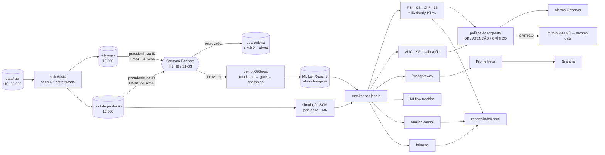
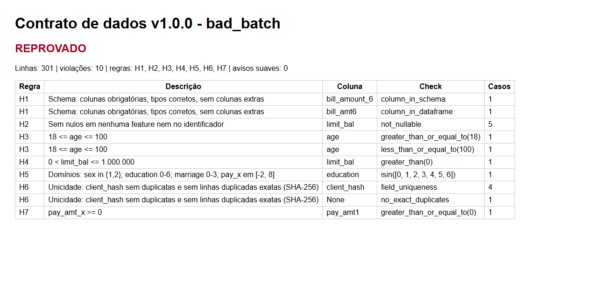
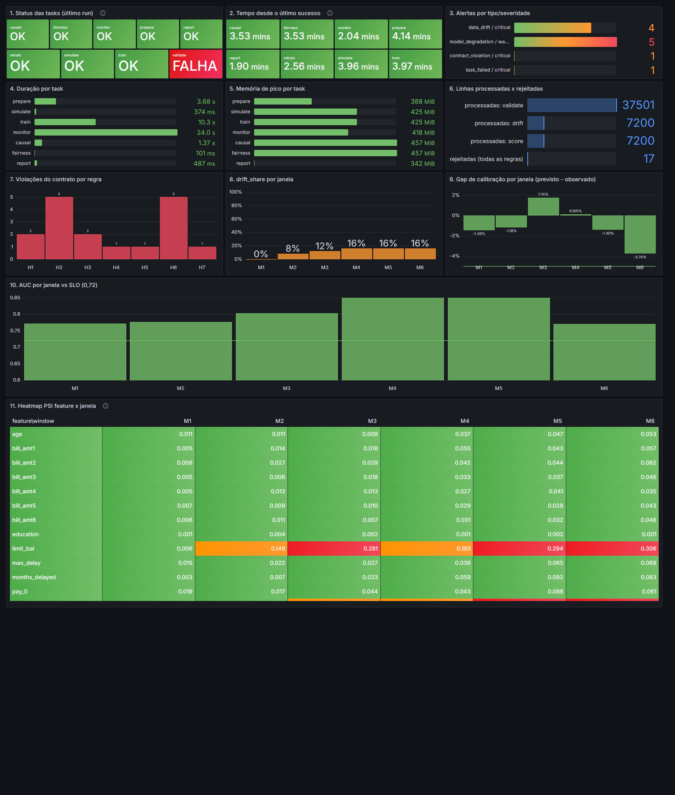
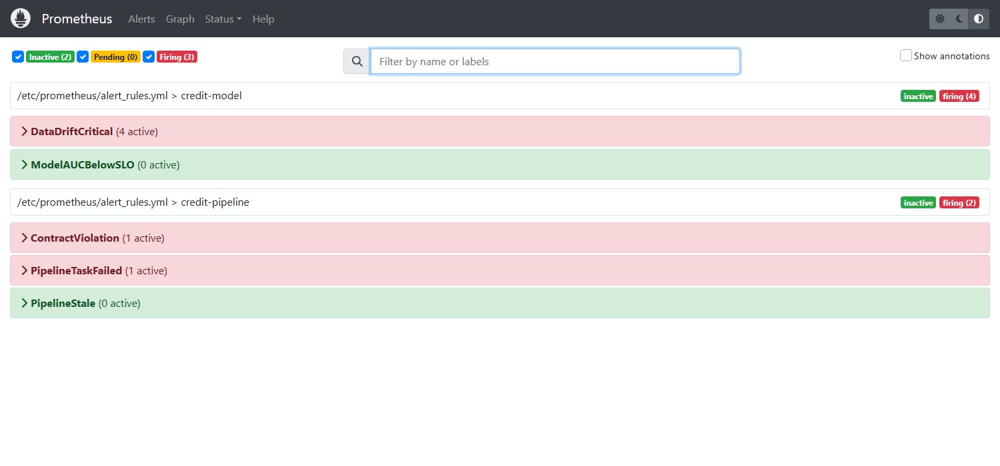
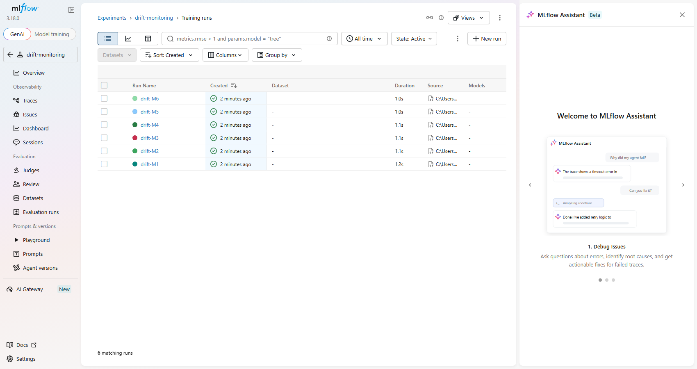
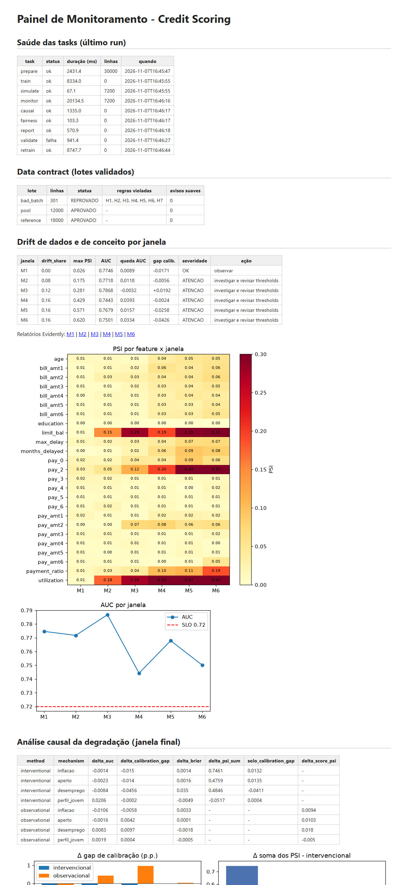
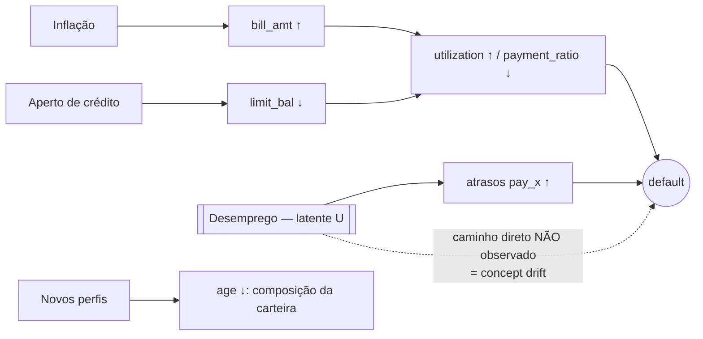

# Sustentação e Confiabilidade de um Modelo de Credit Scoring

> Tech Challenge — Fase 4 (MLET). Data contracts, simulação e detecção de drift, observabilidade,
> análise causal da degradação e governança LGPD em volta de um classificador de inadimplência.

[](https://github.com/CirqueiraLeandro/tech-challenge-fase4/actions/workflows/ci.yml)

**Repositório:** <https://github.com/CirqueiraLeandro/tech-challenge-fase4>

**Vídeo STAR (≤ 5 min):** _pendente — gravar e colocar o link aqui antes da entrega._

**Painel offline (abre direto do repositório, sem servidor):** [`reports/index.html`](reports/index.html)

**Documentos formais:** [Model Card](docs/MODEL_CARD.pdf) · [ML Canvas](docs/ML_CANVAS.pdf)

---

## 1. Visão geral (STAR)

| | |
|---|---|
| **Situation** | Uma fintech tem um modelo de crédito em produção. Com inflação, aperto de crédito, desemprego e novos perfis de clientes, suspeita-se de **degradação silenciosa**: o pipeline "roda verde", mas as decisões pioram. |
| **Task** | Construir a camada de sustentação: impedir que lixo entre no modelo, detectar a degradação, torná-la visível, **explicar sua causa** e governar o tratamento dos dados (LGPD). |
| **Action** | Contrato de dados Pandera (8 regras rígidas + 3 suaves) → modelo XGBoost → simulação causal de 6 janelas → PSI/KS/Chi²/JS + Evidently → MLflow + Prometheus/Grafana → análise causal intervencional × observacional → política de resposta + retreino → privacidade e fairness implementados e testados. |
| **Result** | Contrato bloqueia o lote corrompido (exit 2); drift detectado a partir de M2 sem falso positivo no controle M1; concept drift aparece como **gap de calibração de −4,3 p.p. em M6** (o desemprego latente explica ~94% dele); retreino com M4+M5 recupera o AUC de M6 de 0,7501 para 0,7702. |

O modelo é **propositalmente simples** (XGBoost tabular): o valor está na validação, no monitoramento,
na causalidade e na governança — não em tuning.

## 2. Arquitetura



## 3. Quick start

Pré-requisitos: Python 3.11, Poetry, Docker Desktop (só para a stack de observabilidade).

```powershell
git clone https://github.com/CirqueiraLeandro/tech-challenge-fase4.git
cd tech-challenge-fase4
poetry install --with dev
copy .env.example .env        # gere a chave: python -c "import secrets; print(secrets.token_hex(32))"
poetry run python -m scripts.download_data
poetry run python -m scripts.validate_env
docker compose up -d          # MLflow :5000, Prometheus :9090, Pushgateway :9091, Grafana :3000
# no .env: MLFLOW_TRACKING_URI=http://localhost:5000 e PUSHGATEWAY_URL=http://localhost:9091
poetry run python -m src.pipeline.cli all
poetry run python -m scripts.make_bad_batch
poetry run python -m src.pipeline.cli validate data/incoming/bad_batch.csv   # exit 2 esperado
poetry run python -m src.pipeline.cli retrain --with-windows M4 M5
```

Sem a stack, deixe `MLFLOW_TRACKING_URI=sqlite:///mlflow.db` e `PUSHGATEWAY_URL=` vazio: o pipeline
roda normalmente e registra `observability_degraded` quando um backend opcional está fora.
Grafana: `http://localhost:3000` (admin/admin). Para ver sem login: `GRAFANA_ANONYMOUS=true docker compose up -d grafana`.

### Makefile × comando direto (Windows não tem `make` por padrão)

| Target | Comando direto |
|---|---|
| `make install` / `dev` | `poetry install --only main` / `poetry install --with dev` |
| `make download-data` | `poetry run python -m scripts.download_data` |
| `make validate-env` | `poetry run python -m scripts.validate_env` |
| `make lint` | `poetry run python -m ruff check src tests scripts` e `… ruff format --check src tests scripts` |
| `make format` | `poetry run python -m ruff format src tests scripts` |
| `make test` | `poetry run python -m pytest -m "not requires_data" --cov=src` |
| `make prepare` | `poetry run python -m src.pipeline.cli prepare` |
| `make train` | `poetry run python -m src.pipeline.cli train` (ou `python -m src.models.train`) |
| `make bad-batch` | `poetry run python -m scripts.make_bad_batch` |
| `make validate-bad` | `poetry run python -m src.pipeline.cli validate data/incoming/bad_batch.csv` |
| `make simulate` | `poetry run python -m src.pipeline.cli simulate` |
| `make monitor` | `poetry run python -m src.pipeline.cli monitor` |
| `make causal` / `fairness` / `report` | `poetry run python -m src.pipeline.cli causal` / `fairness` / `report` |
| `make retrain` | `poetry run python -m src.pipeline.cli retrain --with-windows M4 M5` |
| `make all` | `poetry run python -m src.pipeline.cli all` |
| `make demo` | `poetry run python -m src.pipeline.cli demo --synthetic` (dados sintéticos, isolado em `demo_output/`) |
| `make obs-up` / `obs-down` | `docker compose up -d` / `docker compose down` |
| `make retention` | `poetry run python -m scripts.apply_retention` (dry-run; `--execute` apaga) |

Exit codes da CLI: `0` sucesso · `1` erro · `2` contrato violado · `3` gate reprovado.

## 4. Requisitos do PDF → onde estão

| Requisito | Evidência |
|---|---|
| Pipeline de validação (data contracts) | `src/contracts/`, [`docs/DATA_CONTRACT.md`](docs/DATA_CONTRACT.md), seção 5 |
| Scripts de simulação e detecção de drift | `src/drift/simulation.py`, `stattests.py`, `detector.py`; seção 6 |
| Dashboards / relatórios HTML | `reports/drift/*.html` (Evidently), [`reports/index.html`](reports/index.html), Grafana (seção 7) |
| Documentação de governança no README | seção 9 (este arquivo) e [`docs/GOVERNANCE.md`](docs/GOVERNANCE.md) |
| Histórico de commits semântico | `git log --oneline` |
| Separação Referência × Produção | `data/reference/` × `data/production/` e `src/data/splitter.py` |
| ≥ 3 regras rígidas | 8 rígidas + 3 suaves (seção 5) |
| Relatório PSI e KS | `reports/drift/drift_summary.csv` (PSI, JS, KS, Chi² por feature × janela) |
| Plano de privacidade (LGPD) | seção 9 |
| Análise causal | seção 8 e [`docs/CAUSAL_ANALYSIS.md`](docs/CAUSAL_ANALYSIS.md) |
| Vídeo STAR | _pendente_ (link no topo) |

**Dataset:** *Default of Credit Card Clients* (UCI id=350, Yeh & Lien, 2009) — 30.000 clientes,
23 variáveis, ~22% de inadimplência. O German Credit (1.000 linhas) não atende o mínimo de 5.000.
Limitações: Taiwan, 2005, sem renda e sem data por cliente — **o "tempo" é simulado em janelas**.

## 5. Etapa 1 — Validação de dados e contratos

Pandera (`DataFrameModel`, `lazy=True`, `strict=True`, `coerce=False`). O lote é **atômico**: qualquer
falha rígida bloqueia a ingestão inteira (circuit breaker), grava `data/quarantine/<run_id>/` e sai com
exit 2. Escolha Pandera × Great Expectations/Deequ/TFDV justificada em
[`docs/TECHNICAL_GUIDE.md`](docs/TECHNICAL_GUIDE.md).

| Id | Regra | Tipo |
|---|---|---|
| H1 | Schema: colunas obrigatórias, tipos, sem colunas extras | rígida |
| H2 | Sem nulos em features e identificador | rígida |
| H3 | `18 <= age <= 100` | rígida |
| H4 | `0 < limit_bal <= 1.000.000` | rígida |
| H5 | Domínios: `sex ∈ {1,2}`, `education 0-6`, `marriage 0-3`, `pay_x ∈ [-2,8]` | rígida |
| H6 | Unicidade do `client_hash` + nenhuma linha duplicada exata (SHA-256) | rígida |
| H7 | `pay_amt_x >= 0` | rígida |
| H8 | Volume mínimo do lote (≥ 100 linhas) | rígida |
| S1 | `bill_amt` fora de [p0,5; p99,5] do reference em > 5% das linhas | suave |
| S2 | `education`/`marriage` não documentados em > 2% das linhas | suave |
| S3 | Média de `limit_bal` desvia > 30% da referência | suave |

**Demonstração (lote corrompido, `make bad-batch && make validate-bad`):** 301 linhas, **10 violações
agregadas** cobrindo H1–H7, 14 linhas afetadas, exit code 2, relatório em
[`reports/contracts/bad_batch_violations.html`](reports/contracts/bad_batch_violations.html):

| Regra | Coluna / check | Casos |
|---|---|---|
| H1 | `bill_amount_6` — `column_in_schema` (coluna renomeada) e `bill_amt6` — `column_in_dataframe` | 1 + 1 |
| H2 | `limit_bal` — `not_nullable` | 5 |
| H3 | `age` — `>= 18` e `<= 100` (idades 15 e 130) | 1 + 1 |
| H4 | `limit_bal` — `> 0` (valor −5000) | 1 |
| H5 | `education` — `isin(0..6)` (valor 9) | 1 |
| H6 | `client_hash` — `field_uniqueness`; `no_exact_duplicates` | 4 + 1 |
| H7 | `pay_amt1` — `>= 0` | 1 |



O reference (18.000) e o pool (12.000) passaram no contrato sem violações nem avisos suaves.

**Modelo baseline** (XGBoost, 300 árvores, `max_depth=4`, `lr=0,05`; fit só no treino; teste 20%
estratificado do reference, 3.600 clientes; números de `models/metrics_train.json`):

| AUC | Gini | KS | F1 | Precision | Recall | Brier |
|---|---|---|---|---|---|---|
| 0,7836 | 0,5671 | 0,4355 | 0,4947 | 0,7021 | 0,3819 | 0,1321 |

Matriz de confusão (threshold 0,5): TN 2675 · FP 129 · FN 492 · TP 304. O **gate** exige AUC ≥ 0,75;
o treino grava em `models/candidate/` e só a promoção escreve em `models/champion/` e move o alias
`champion` do MLflow (um teste garante que modelo reprovado **não** altera o champion). Persistência
portável: JSON nativo do XGBoost + metadata (sem pickle entre ambientes). Explicabilidade (LGPD art. 20):
`reason codes` por cliente via contribuições SHAP nativas (`pred_contribs`), com teste de que
soma das contribuições + bias = margem prevista.

## 6. Etapa 2 — Simulação e detecção de drift

**Simulação causal (SCM)** — `configs/drift_scenario.yaml`. O pool vira 6 janelas mensais **disjuntas**
(M1..M6) de **1.200 linhas**, com intensidade `t_k = k/5`. **M1 (t=0) é a janela de controle** e não
pode gerar alerta. Quatro mecanismos independentes e desligáveis (afetam ≥ 10 colunas):

| Mecanismo | Tipo | Efeito |
|---|---|---|
| `inflacao` | covariate shift | `bill_amt1..6 *= 1+0,40t`; `pay_amt1..6 *= 1+0,05t` |
| `aperto` | covariate shift | `limit_bal *= 1−0,25t` |
| `desemprego` | **concept drift** | choque latente `U~Bernoulli(0,20t)` (não observado): `pay_0`, `pay_2` +1..2 e, se `default=0`, vira 1 com prob. 0,5 |
| `perfil_jovem` | composição | amostragem com peso `1+1,5t` para `age<30` |

> **Desvio da especificação, documentado:** janelas de **1.200** linhas (a especificação diz ~2.000). Com
> split 60/40 o pool tem 12.000 linhas; janelas disjuntas de 2.000 consumiriam o pool inteiro e o
> mecanismo `perfil_jovem` (viés de amostragem) não teria de onde escolher. Cada janela é sorteada de um
> bloco de 2.000. Todas passam nas regras rígidas do contrato.

**Testes estatísticos** (`src/drift/stattests.py`, padrão Strategy): PSI (bins por quantis do
reference, 10 bins; < 0,10 estável / 0,10–0,20 moderado / ≥ 0,20 severo), KS, Chi² (categóricas) e
Jensen-Shannon. **Política:** severidade = magnitude (PSI/JS); significância = KS/Chi². Uma feature só é
"drifted" se **PSI ≥ 0,10 e p-value significativo** — com n grande o KS acusa diferenças irrelevantes
(há teste: shift de 0,02 desvio-padrão com n=200.000 é significativo no KS mas não passa no PSI).

**Evidently** (0.7.23, API nova `Report([DataDriftPreset(method="psi", …)]).run(...)`): o método é
configurado **explicitamente** para PSI — o default do Evidently seria Wasserstein para n > 1000. Um
relatório HTML por janela em `reports/drift/` (commitados M1 e M6; M2–M5 são regeneráveis).

**Resultados reais por janela** (`reports/drift/drift_summary.json`, champion baseline):

| Janela | Features em drift (próprio) | drift_share | Máx. PSI | AUC | Queda AUC | Gap calib. | Severidade (política) |
|---|---|---|---|---|---|---|---|
| M1 (controle) | — | 0,00 | 0,026 | 0,7746 | +0,0089 | −0,0171 | **OK** |
| M2 | limit_bal, utilization | 0,08 | 0,175 | 0,7718 | +0,0118 | −0,0056 | ATENÇÃO |
| M3 | limit_bal, pay_2, utilization | 0,12 | 0,281 | 0,7868 | −0,0032 | +0,0192 | ATENÇÃO |
| M4 | + payment_ratio | 0,16 | 0,429 | 0,7443 | +0,0393 | −0,0024 | ATENÇÃO |
| M5 | limit_bal, pay_2, utilization, payment_ratio | 0,16 | 0,571 | 0,7679 | +0,0157 | −0,0258 | ATENÇÃO |
| M6 | limit_bal, pay_2, utilization, payment_ratio | 0,16 | 0,620 | 0,7501 | +0,0334 | −0,0426 | ATENÇÃO |

Features **degradadas em M6** (PSI próprio / Evidently): `utilization` 0,621 / 1,445 · `pay_2` 0,331 /
0,325 · `limit_bal` 0,306 / 0,445 · `payment_ratio` 0,186 / 0,069. Os **controles negativos**
(`education`, `pay_3..6`) ficam abaixo de 0,02 em M6 (teste automatizado). Cross-check
próprio × Evidently: M1 sem nenhuma feature sinalizada nos dois; M6 com Jaccard 0,75 (a única divergência é
`payment_ratio`, cujo PSI difere entre os binnings — 0,186 contra 0,069).

**Leitura honesta dos resultados.**

- A **política não chegou a CRÍTICO** em nenhuma janela: o critério exige PSI ≥ 0,20 **e** queda de AUC
  ≥ 0,05, ou |gap| > 5 p.p.; em M6 a queda foi de 0,033 e o gap de −4,3 p.p. Os parâmetros do cenário
  foram mantidos como especificados (não foram ajustados para forçar um CRÍTICO). O alerta de **PSI ≥ 0,20**
  (`DataDriftCritical`) dispara de M3 a M6.
- O **AUC é um sinal ruidoso**: janelas de 1.200 linhas oscilam na ordem de 0,01–0,02 (M3 ficou *acima* do
  baseline; M5 recuperou parcialmente). O concept drift aparece com mais nitidez na **calibração** (gap de
  −4,3 p.p. em M6: o modelo prevê ~4 p.p. a menos de inadimplência do que ocorre) e no **Brier** (de 0,1394 em
  M1 para 0,1733 em M6).
- Mecanismo → sinal: PSI alto sem queda de desempenho é falso alarme provável (a "mudança de preços" move
  `utilization` com impacto pequeno no AUC); o desemprego latente quase não move P(X) e degrada a calibração.

**Política de resposta** (`configs/monitoring.yaml`): OK → observar · ATENÇÃO → investigar e revisar
thresholds · CRÍTICO → retreinar com janela recente rotulada + revisão humana.

**Retreino (fechamento do ciclo / CT):** `retrain --with-windows M4 M5` treina com reference + M4 + M5 e
mede em M6 (hold-out, não usado no treino); mesmo gate e promoção:

| Hold-out M6 | AUC | Brier | Gap de calibração |
|---|---|---|---|
| Antes (champion baseline) | 0,7501 | 0,1733 | −0,0426 |
| Depois (retreinado) | 0,7702 | 0,1685 | −0,0374 |

AUC no teste do reference após o retreino: 0,7845 (sem regressão). A recuperação é **parcial**: o gap de
calibração só melhora ~0,5 p.p., provavelmente porque M4/M5 têm menos choque de desemprego (`t` menor) que M6 — hipótese não testada isoladamente.

## 7. Etapa 3 — Observabilidade

Duas camadas complementares (`docs/MONITORING.md` detalha métricas, SLOs, queries e runbook):

- **MLflow** (servidor `:5000`, SQLite em volume, aliases `champion`/`challenger`): experimentos
  `credit-training` (params, métricas, modelo com signature + input_example, matriz de confusão, tags de
  hash do dataset/git/contrato), `data-validation` (1 run por lote) e `drift-monitoring` (**1 run por janela**
  com `step=k`, HTML do Evidently como artefato).
- **Pushgateway → Prometheus → Grafana**: métricas `credit_*` (status/duração/memória por task, linhas
  processadas/rejeitadas, status do contrato, PSI por feature × janela, drift_share, AUC, gap de calibração,
  alertas, último sucesso), 5 regras de alerta validadas com `promtool` e dashboard com **11 painéis**
  provisionado automaticamente.





Alertas ativos após o run completo (Prometheus `/alerts`): `DataDriftCritical` (M3, M4, M5, M6),
`ContractViolation` (lote `incoming`) e `PipelineTaskFailed` (task `validate`, resultado esperado da
demonstração do bad batch); `ModelAUCBelowSLO` e `PipelineStale` inativos (AUC mínimo 0,744 > SLO 0,72).

Logs estruturados em JSON (`logs/pipeline.jsonl`, `logs/alerts.jsonl`) **sem dados pessoais** (teste
automatizado). O painel HTML consolidado ([`reports/index.html`](reports/index.html)) agrega status das
tasks, contratos, heatmap PSI, curva de AUC, causal, fairness e retreino, sem depender de servidor.



Tempos reais do último run completo (`logs/pipeline.jsonl`): prepare 2,4 s · train 8,3 s · simulate 0,07 s ·
monitor 20,1 s (6 janelas, incl. Evidently e MLflow) · causal 1,3 s · fairness 0,1 s · report 0,6 s.

## 8. Causalidade

Grafo causal do cenário simulado:



**Atribuição intervencional** (verdade de campo: controlamos o gerador). Em M6, regenera-se a janela com a
MESMA seed desligando um mecanismo por vez (`do(mecanismo = referência)`); cada mecanismo tem sorteios
independentes, então desligar um não altera os demais. Convenção: `Δ = (janela completa) − (sem o mecanismo)`.
Janela completa: AUC 0,7501, gap −0,0426, Brier 0,1733; sem nenhum mecanismo: AUC 0,7547, gap +0,0010, Brier 0,1377.

| Mecanismo | Δ AUC | Δ gap calibração | Δ Brier | Δ soma PSI | Efeito isolado no gap |
|---|---|---|---|---|---|
| desemprego (latente) | −0,0084 | **−0,0456** | **+0,0350** | +0,485 | −0,0411 |
| inflação | −0,0014 | −0,0150 | +0,0014 | **+0,746** | +0,0132 |
| aperto | −0,0023 | −0,0140 | +0,0016 | +0,476 | +0,0135 |
| perfil jovem | **+0,0206** | −0,0002 | −0,0049 | −0,052 | +0,0004 |

- Dominante **em dados** (soma dos PSI): `inflacao`. Dominante **em desempenho** (calibração/Brier): `desemprego`,
  que sozinho responde por −4,11 p.p. do gap total de −4,36 p.p. (~94%).
- **Não-aditividade:** a soma dos efeitos isolados no gap (−1,40 p.p.) difere do efeito conjunto (−4,36 p.p.);
  os mecanismos interagem (hipótese: inflação e aperto elevam o risco previsto, o que muda o tamanho do descompasso causado pelo desemprego; a interação não foi decomposta).
- O `perfil_jovem` *aumenta* o AUC (+0,02): clientes < 25 anos são mais fáceis de ranquear (AUC 0,81 contra
  0,78 no reference) — mudança de composição que não é degradação.

**Atribuição observacional** (o que se faria em produção): reverte-se cada grupo de features que driftaram
para a distribuição do reference por mapeamento de quantis e mede-se o efeito.

| Mecanismo (grupo de features) | Δ AUC | Δ gap observacional | Real (intervencional) | Reproduz? |
|---|---|---|---|---|
| desemprego (`pay_0`, `pay_2`, `max_delay`, `months_delayed`) | +0,0083 | **+0,0097** | −0,0456 | **não — sinal oposto** |
| inflação (`bill_amt`, `pay_amt`, `utilization`, `payment_ratio`) | −0,0106 | −0,0058 | −0,0150 | não (magnitude 39%) |
| aperto (`limit_bal`) | −0,0016 | +0,0042 | −0,0140 | não — sinal oposto |
| perfil jovem (`age`) | +0,0019 | +0,0004 | −0,0002 | irrelevante |

**Conclusões.** (1) *Correlação ≠ causa*: `utilization` tem o PSI mais alto (0,62) e a inflação domina a
mudança em P(X), mas a degradação de **calibração** vem do desemprego — um modelo disparado por PSI faria
alarme falso ao reagir à inflação. (2) *Covariate × concept drift exigem respostas diferentes*: reponderar/
recalibrar para a mudança de P(X) × retreinar com rótulos novos e buscar um **proxy da variável latente**
(ex.: dado de emprego — sujeito à avaliação de minimização da LGPD). (3) O diagnóstico observacional **falha
exatamente onde esperado**: o choque U é latente, invisível em P(X), e reverter `pay_0/pay_2` produz um Δ de
sinal contrário ao real. (4) Prescrição alinhada à política: ATENÇÃO/CRÍTICO → retreino com janelas rotuladas
(seção 6) + revisão humana. Teste automatizado: com um único mecanismo ligado, a atribuição intervencional o
identifica como dominante (`tests/test_causal_fairness.py`). Detalhes em
[`docs/CAUSAL_ANALYSIS.md`](docs/CAUSAL_ANALYSIS.md).

## 9. Governança e LGPD (Privacy by Design e by Default)

As medidas são **implementadas e testadas**, não só descritas.

### 9.1 Inventário e classificação de dados

| Coluna | Categoria LGPD | Finalidade | No modelo? | Tratamento |
|---|---|---|---|---|
| `client_id` | dado pessoal (identificador) | vincular registros | não | **pseudonimizado** (HMAC-SHA256 + chave secreta no `.env`) na ingestão; o ID cru nunca sai da ingestão |
| `sex`, `marriage` | dado pessoal, **alto risco discriminatório** | auditoria de vieses | **não** | excluídos das features (minimização, art. 6º III; não discriminação, art. 6º IX); mantidos só em área segregada (`audit_view`) |
| `age` | dado pessoal | risco de crédito | sim | usado; monitorado na auditoria por faixa etária |
| `education` | dado pessoal | risco de crédito | sim | feature; **risco de proxy socioeconômico** documentado |
| `limit_bal`, `bill_amt*`, `pay_amt*`, `pay_*` | dado pessoal financeiro | análise de risco | sim | necessários à finalidade |

**Pseudonimização ≠ anonimização** (art. 5º, III e art. 12): o dado pseudonimizado **continua sendo dado
pessoal**, pois a chave permite reidentificar. **Observação jurídica:** pela LGPD (art. 5º, II) "sexo" e
"estado civil" **não** fazem parte do rol de dados *sensíveis* (origem racial, religião, opinião política,
saúde, vida sexual, genética, biometria); a exclusão é por **risco de discriminação**, não por classificação
legal. O código impõe isso (`PII_COLUMNS`, `PROTECTED_ATTRIBUTES`, `MODEL_FEATURES`) e um teste garante
interseção vazia entre `MODEL_FEATURES` e `{client_id, client_hash, sex, marriage}`.
**Custo da minimização medido:** AUC com `sex`/`marriage` = 0,7828 × sem = 0,7836 — excluí-los não custa
desempenho (princípio da funcionalidade total).

### 9.2 Base legal

- **Art. 7º, X — proteção do crédito** (base principal para análise de risco/concessão), com **art. 7º, V**
  (execução de contrato/procedimentos preliminares a pedido do titular) como complemento.
- **Por que não consentimento:** a assimetria de poder e a revogabilidade inviabilizariam a análise de risco
  (o titular revogaria o consentimento exatamente quando o risco é maior).
- Marcos setoriais correlatos: Lei 12.414/2011 (Cadastro Positivo) e CDC art. 43.
- **Art. 20 — revisão de decisão automatizada** e informação sobre critérios: atendido pelos *reason codes*
  (`src/models/explain.py`) e por um fluxo de **revisão humana** (decisões CRÍTICAS e contestações vão a analista).
- **Direitos do titular (art. 18):** acesso, correção, eliminação, portabilidade e informação — a eliminação
  é por `client_hash` nos dados operacionais, respeitando os prazos legais de guarda; os demais são atendidos
  a partir do mapeamento `client_id → client_hash` (que exige a chave, mantida só pelo controlador).

### 9.3 Privacy by Design — 7 princípios → decisões concretas

| Princípio | Implementação | Arquivo |
|---|---|---|
| Proativo, não reativo | contrato bloqueia o lote **antes** do modelo | `src/contracts/` |
| Privacidade como padrão | webhook e Pushgateway **desligados** por default; PII removida por default; logs sem PII; retenção em dry-run | `src/config.py`, `src/privacy/` |
| Incorporada ao design | módulo dedicado de privacidade | `src/privacy/` |
| Funcionalidade total | minimização sem perda de AUC (medido) | `src/models/train.py` |
| Segurança ponta a ponta | chave HMAC em `.env` (obrigatória fora de teste), quarentena sem PII, dados no `.gitignore` | `.env.example`, `.gitignore` |
| Visibilidade e transparência | Model Card, *reason codes*, ROPA | `docs/MODEL_CARD.pdf`, `docs/GOVERNANCE.md` |
| Respeito ao usuário | direitos dos arts. 18 e 20 | seção 9.2 |

O CI nunca usa dado real (dados sintéticos como medida de privacidade).

### 9.4 Mitigação de vieses (`src/governance/fairness.py`, `reports/fairness/fairness_report.json`)

Regra dos 80% (Disparate Impact = menor taxa de aprovação / maior), Equal Opportunity (diferença na taxa de
aprovação de **bons pagadores**) e AUC por grupo — no teste do reference **e** em M6 (o drift pode criar viés).
Aprovado = score < 0,5.

| Conjunto | Atributo | Taxas de aprovação | DI | Regra 80% | Dif. oportunidade |
|---|---|---|---|---|---|
| reference (teste) | sexo | F 0,887 · M 0,869 | 0,980 | ok | 0,016 |
| reference (teste) | faixa etária | <25: 0,802 · 25–40: 0,890 · 40–60: 0,881 · >60: 0,914 (n=35) | **0,877** | ok | 0,042 |
| M6 | sexo | F 0,866 · M 0,864 | 0,998 | ok | 0,017 |
| M6 | faixa etária | <25: 0,770 · 25–40: 0,891 · 40–60: 0,851 (>60 omitido: n<30) | **0,864** | ok | 0,043 |

Leitura: sem violação da regra dos 80%, mas os **menores de 25** têm a menor aprovação (0,802 → 0,770 em M6,
com DI caindo de 0,877 para 0,864). Causas prováveis: proxy por histórico curto de crédito/limites baixos e
menor representatividade (313 clientes no teste). Mitigação proposta: revisar features correlatas à idade,
ajustar o threshold por política (com análise de custo), **monitorar o DI como métrica contínua** no dashboard
e revisão humana nos casos de fronteira. Em M6 o AUC por sexo diverge (F 0,765 × M 0,725), a acompanhar.

### 9.5 Plano de retenção (executável — `scripts/apply_retention.py`, **dry-run por padrão**)

| Artefato | Conteúdo | Prazo | Justificativa | Mecanismo |
|---|---|---|---|---|
| `data/raw` | bruto com ID | `RETENTION_RAW_DAYS` = 3650 d (10 anos) | prazo legal setorial de guarda (referência: Cadastro Positivo/relações de consumo); enquanto durar o projeto | `apply_retention.py --execute` |
| `data/quarantine` | lotes rejeitados | `RETENTION_QUARANTINE_DAYS` = 30 d | tempo de investigação com o produtor | idem |
| `logs/*.jsonl` | eventos sem PII | `RETENTION_LOGS_DAYS` = 90 d | operação/auditoria | rotação 10 MB × 5 + purge |
| `reports/`, `mlruns` | agregados sem PII | vida útil do modelo + auditoria | evidência | manual |
| modelos | artefatos | versões aposentadas: 5 anos | auditabilidade de decisões (art. 20) | manual |

Testado com arquivos de `mtime` manipulado (dry-run não apaga; `--execute` apaga só o vencido e preserva `.gitkeep`).

### 9.6 RIPD (art. 38) e ROPA (art. 37) — resumo

| Risco | Medida | Risco residual |
|---|---|---|
| Reidentificação | HMAC com chave secreta; ID cru fora da ingestão; quarentena/relatórios só com hash curto | baixo (chave comprometida reidentifica) |
| Discriminação | exclusão de `sex`/`marriage`; auditoria de DI/EO; revisão humana | médio (proxies como `education`/`age`) |
| Vazamento | `.gitignore` de dados, `.env` fora do git, retenção, logs sem PII | baixo |
| **Decisão errada por drift** | monitoramento, política de resposta, alertas, retreino com gate | médio (rótulo chega com atraso) |

O **drift também é risco de compliance**: um modelo degradado produz decisões automatizadas incorretas ou
injustas — por isso a política de resposta (seção 6) é um **controle de governança**. ROPA e RIPD completos
em [`docs/GOVERNANCE.md`](docs/GOVERNANCE.md).

## 10. Testes e qualidade

- **159 testes**, **98,67% de cobertura** de `src/` (`pytest --cov=src`, meta ≥ 90 testes e ≥ 95%); a suíte
  roda sem o dataset real e grava seus logs num diretório temporário (nunca em `logs/` do projeto).
  `ruff check`, `ruff format --check` e `mypy src scripts` sem erros; `pre-commit` com os mesmos hooks.
- CI (`.github/workflows/ci.yml`) com 4 jobs: `lint`, `test`, `contract-gate` (afirma exit 2 no lote ruim e
  exit 0 no limpo) e `drift-demo` (`demo --synthetic` + upload de `reports/`).
- Patterns: **Strategy** (stattests), **Factory** (modelos/stattests), **Template Method** (`Task`),
  **Observer** (`AlertDispatcher`). Funções ≤ 20 linhas úteis, type hints, docstrings em PT-BR.

## 11. Lições aprendidas

- **Validar cedo a integração de maior risco** pagou: o Evidently 0.7.23 **não importa com pandas 3.1** (o
  resolver do Poetry aceitou a combinação; só o import em runtime acusou) → `pandas>=2.3.3,<3`.
- Um bug real encontrado na validação ponta a ponta: as regras suaves quebravam com *schema drift*
  (coluna ausente) — justamente o caso que o contrato deve reportar; corrigido e coberto por teste.
- O retreino sobrescrevia as métricas do baseline (`metrics.json`), que o Model Card cita → arquivos por
  execução (`metrics_train.json`, `metrics_retrain.json`).
- MLflow com backend HTTP fora do ar travava a suíte nos *retries* → 0 retries e timeout de 3 s (degradação rápida).
- O PSI é limitado por n e por binning (PSI próprio × Evidently divergem em `payment_ratio`); sinal de
  desempenho (AUC) é ruidoso em janelas pequenas — por isso a política combina magnitude, desempenho e calibração.
- **Isolamento dos testes também vale para logs:** o logger é configurado na importação e a suíte gravava no
  `logs/pipeline.jsonl` do projeto; como o painel lê o último `task_fim` de cada task, ele passou a exibir
  execuções de teste (inclusive falhas provocadas de propósito). Correção: a suíte loga em diretório
  temporário e o painel lê o arquivo efetivamente usado pelo logger (`current_log_file()`), com teste.
- Uma revisão estática final (mypy + auditoria de tamanho de função) encontrou 6 funções acima de 20 linhas
  úteis e 5 erros de tipo — entre eles `np.array_split` sobre DataFrame, que gerava `FutureWarning`; todos
  corrigidos sem mudar resultados (as janelas M1..M6 foram comparadas linha a linha antes e depois).
- **Testar o caminho de exceção, não só o feliz:** o fallback de download pelo OpenML nunca tinha rodado de
  verdade. Forçando a falha da fonte principal, ele quebrava: o OpenML entrega `x1..x23` em minúsculas e a busca
  por nome é ambígua (a versão 2 é um recorte de 13.272 linhas sem sexo/escolaridade/estado civil). Correção:
  `data_id=42477` fixo e reconhecimento case-insensitive; o fallback agora devolve dados idênticos ao UCI nas
  24 colunas e nos 30.000 IDs. O workflow do CI também passou pelo `actionlint` (um aviso de shellcheck corrigido).

## 12. Limitações

Dataset de Taiwan (2005), sem renda nem data por cliente; **tempo simulado** (os mecanismos são hipóteses
controladas, não a realidade); rótulo revelado sem atraso (em produção chega meses depois); sem renda, a
discriminação indireta não é totalmente auditável; o modelo **não deve ser usado em decisão de crédito real**.
Pendência de entrega: link do vídeo STAR (topo deste README).

## 13. Documentação

[`docs/PROJECT_OVERVIEW.md`](docs/PROJECT_OVERVIEW.md) · [`docs/TECHNICAL_GUIDE.md`](docs/TECHNICAL_GUIDE.md) ·
[`docs/DATA_CONTRACT.md`](docs/DATA_CONTRACT.md) · [`docs/DRIFT_REPORT.md`](docs/DRIFT_REPORT.md) ·
[`docs/CAUSAL_ANALYSIS.md`](docs/CAUSAL_ANALYSIS.md) · [`docs/MONITORING.md`](docs/MONITORING.md) ·
[`docs/GOVERNANCE.md`](docs/GOVERNANCE.md) · [`docs/MODEL_CARD.pdf`](docs/MODEL_CARD.pdf) ·
[`docs/ML_CANVAS.pdf`](docs/ML_CANVAS.pdf)
