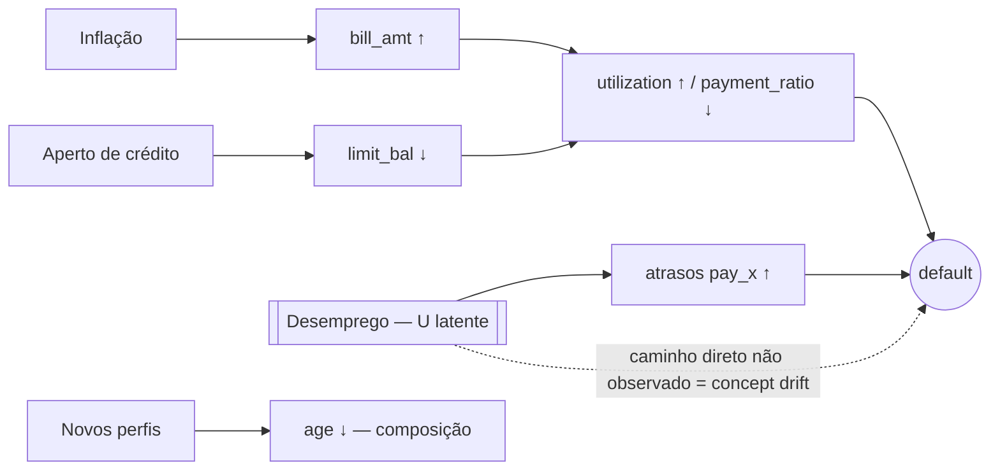

# Análise Causal da Degradação

Implementação: `src/drift/causal.py`; saídas: `reports/causal/attribution.csv|json|png`. Janela analisada: **M6**
(`t = 1`). Não há aula específica de causalidade no material; a análise é tratada com rigor e honestidade sobre o
que ela consegue e **não** consegue afirmar.

## 1. Grafo causal do cenário simulado

O desemprego atua por **dois** caminhos: um observável (atrasos `pay_0`, `pay_2`) e um **direto e não observado**
(`default` 0 → 1 com prob. 0,5 entre os atingidos). O segundo é o que altera P(y|X) — concept drift genuíno.

## 2. Atribuição intervencional (verdade de campo)

Como controlamos o gerador, regeneramos M6 com a **mesma seed** desligando um mecanismo por vez
(`do(mecanismo = referência)`). Cada mecanismo consome um stream de números aleatórios independente, de modo
que desligar um **não** altera os sorteios dos outros (verificado em `tests/test_drift.py`). Para o
`perfil_jovem` (que muda a *seleção* das linhas) a seleção usa chaves de Efraimidis-Spirakis com os mesmos
uniformes, então a amostra muda pouco entre os cenários.

Convenção: `Δ = métrica(janela completa) − métrica(sem o mecanismo)` (o efeito de o mecanismo estar *ligado*).
Referências: janela completa AUC 0,7501 / gap −0,0426 / Brier 0,1733; nenhum mecanismo AUC 0,7547 / gap +0,0010 /
Brier 0,1377.

| Mecanismo | Δ AUC | Δ gap | Δ Brier | Δ drift_share | Δ soma PSI | Efeito isolado (gap) | Efeito isolado (soma PSI) |
|---|---|---|---|---|---|---|---|
| inflacao | −0,0014 | −0,0150 | +0,0014 | +0,04 | **+0,746** | +0,0132 | +1,090 |
| aperto | −0,0023 | −0,0140 | +0,0016 | +0,04 | +0,476 | +0,0135 | +0,636 |
| desemprego | −0,0084 | **−0,0456** | **+0,0350** | +0,04 | +0,485 | −0,0411 | +0,460 |
| perfil_jovem | **+0,0206** | −0,0002 | −0,0049 | 0,00 | −0,052 | +0,0004 | −0,026 |

- **Dominante em dados** (soma dos PSI): inflação. **Dominante em desempenho** (gap/Brier): desemprego —
  −4,11 p.p. isolado de um efeito total de −4,36 p.p. (≈ 94%).
- **Não-aditividade:** soma dos efeitos isolados no gap = −1,40 p.p. × efeito conjunto = −4,36 p.p. Os mecanismos
  interagem; a interação **não** foi decomposta (hipótese: inflação e aperto alteram o risco previsto e, com ele, o
  tamanho do descompasso causado pelo desemprego).
- O `perfil_jovem` eleva o AUC em ~0,02 — menores de 25 anos são mais fáceis de ranquear (AUC 0,81 × 0,78). Mudança
  de composição ≠ degradação: um *trigger* só por PSI de `age` (0,053, estável) nem a veria.
- Ruído: janelas de 1.200 linhas; diferenças de AUC da ordem de 0,01 não são conclusivas. A conclusão central se
  apoia em gap/Brier, onde o efeito (−4,6 p.p.; +0,035 de Brier) é bem maior que as oscilações de AUC observadas.

## 3. Atribuição observacional (o que se faria em produção)

Sem conhecer o gerador, reverte-se cada **grupo de features** que driftou para a distribuição do reference por
mapeamento de quantis (preservando a ordem) e mede-se o efeito no score/AUC. Grupos (hipótese do analista):
inflação = `bill_amt*`, `pay_amt*`, `utilization`, `payment_ratio`; aperto = `limit_bal`; desemprego = `pay_0`,
`pay_2`, `max_delay`, `months_delayed`; perfil = `age`.

| Mecanismo | Δ AUC | Δ gap obs. | Δ gap real | Δ score-PSI | Reproduz? |
|---|---|---|---|---|---|
| desemprego | +0,0083 | +0,0097 | −0,0456 | 0,0180 | **não — sinal oposto** |
| inflação | −0,0106 | −0,0058 | −0,0150 | 0,0094 | não (≈ 39% da magnitude) |
| aperto | −0,0016 | +0,0042 | −0,0140 | 0,0103 | não — sinal oposto |
| perfil jovem | +0,0019 | +0,0004 | −0,0002 | −0,0050 | irrelevante |

Critério de concordância (`observational_matches_intervention` em `attribution.json`): mesmo sinal **e** ≥ 50% da
magnitude do Δ gap real. Nenhum mecanismo atende.

**Onde falha e por quê.** (a) *Desemprego:* o choque U é latente; reverter `pay_0/pay_2` (o rastro observável)
reduz o risco previsto e **piora** o descompasso, sinal contrário ao efeito real — a parte do efeito que passa por
um caminho não observado é invisível a qualquer reversão em P(X). (b) *Aperto e inflação:* as features movem o
score, mas o score não é o que degrada a calibração; reverter reduz o PSI do score (0,009–0,010) sem recuperar o
gap. O diagnóstico observacional serve para **localizar** o que mudou em P(X), não para **atribuir** a degradação.

## 4. Conclusões

1. **Correlação ≠ causa.** `utilization` tem o maior PSI (0,62) e a inflação domina a mudança em P(X), mas a
   degradação da calibração vem do desemprego. Um gatilho de retreino por PSI reagiria (falso alarme) à inflação.
2. **Covariate × concept drift pedem respostas diferentes:** mudança em P(X) (inflação, aperto) → recalibrar/
   reponderar; mudança em P(y|X) (desemprego) → retreinar com rótulos novos **e** buscar um proxy da variável
   latente (ex.: dado de emprego), o que exige avaliação de minimização/finalidade da LGPD.
3. **Rótulos importam.** Sem rótulos só se vê o PSI (e o PSI do score, que foi baixo — 0,054 em M6); o concept
   drift só aparece no gap de calibração e no Brier, que dependem do desfecho (atrasado na vida real).
4. **Prescrição alinhada à política:** ATENÇÃO → investigar (este relatório); CRÍTICO → retreino com janelas
   rotuladas (`retrain`) + revisão humana. O retreino com M4+M5 recuperou o AUC de M6 de 0,7501 para 0,7702, mas o
   gap só de −4,26 p.p. para −3,74 p.p.: recuperação parcial.

## 5. Teste automatizado

`tests/test_causal_fairness.py`: com **um único mecanismo ligado** (`aperto` ou `inflacao`) a atribuição
intervencional o identifica como dominante em dados e os demais têm Δ = 0; com apenas `desemprego` ligado ele é
dominante em calibração.
